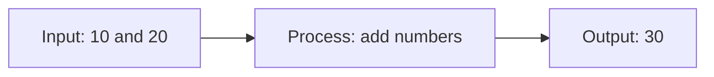
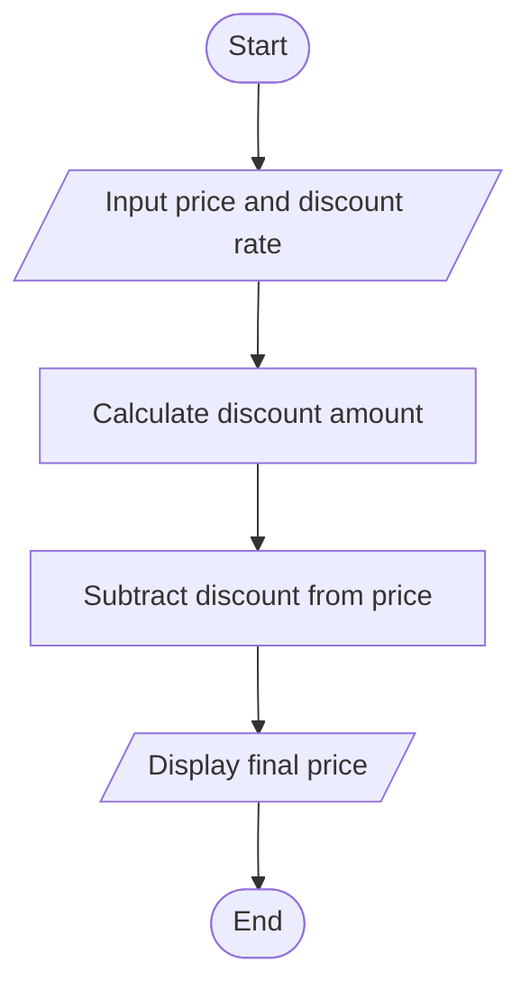
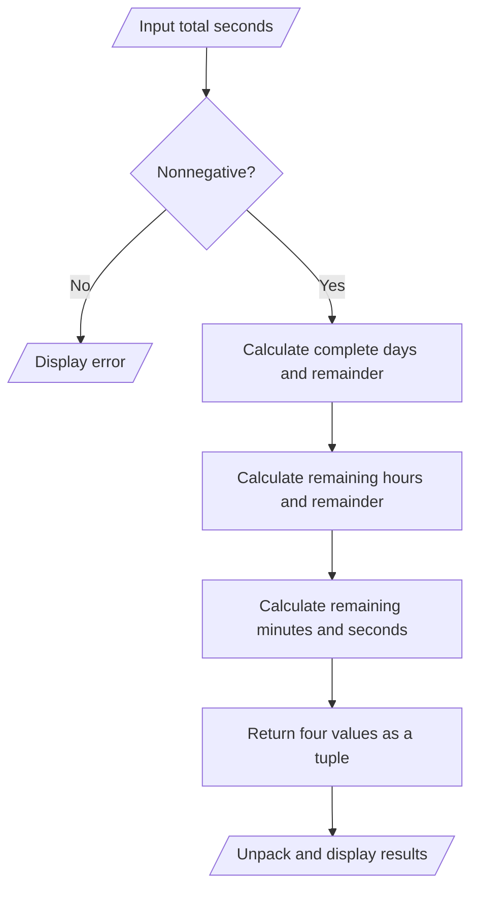

# Day 01 — Python Programming Fundamentals

> Big Tech Software Engineering Preparation | Month 01 · Week 01 · Day 01
>
> **Status:** Completed | **Final coding assessment:** 10/10

## Table of Contents

- [1. Learning objectives](#1-learning-objectives)
- [2. Programming fundamentals](#2-programming-fundamentals)
- [3. Environment setup](#3-environment-setup)
- [4. Variables and naming conventions](#4-variables-and-naming-conventions)
- [5. Data types and dynamic typing](#5-data-types-and-dynamic-typing)
- [6. Operators](#6-operators)
- [7. Input, output and type conversion](#7-input-output-and-type-conversion)
- [8. String formatting](#8-string-formatting)
- [9. Problem-solving methodology](#9-problem-solving-methodology)
- [10. Worked example: discount calculator](#10-worked-example-discount-calculator)
- [11. Functions, return values and tuple unpacking](#11-functions-return-values-and-tuple-unpacking)
- [12. Worked example: simple interest](#12-worked-example-simple-interest)
- [13. Worked example: time conversion](#13-worked-example-time-conversion)
- [14. Introduction to complexity](#14-introduction-to-complexity)
- [15. Practice exercises and challenges](#15-practice-exercises-and-challenges)
- [16. Assessment and lessons learned](#16-assessment-and-lessons-learned)
- [17. Interview revision questions](#17-interview-revision-questions)
- [18. Revision checklist and next steps](#18-revision-checklist-and-next-steps)

---

## 1. Learning objectives

By the end of Day 1, I should be able to:

- Explain the input–process–output model.
- Write and run basic Python programs independently.
- Use variables, basic data types and meaningful variable names.
- Explain dynamic typing and type conversion.
- Apply arithmetic, comparison and logical operators correctly.
- Use `//` and `%` to solve quotient-and-remainder problems.
- Take user input, perform calculations and format results.
- Write simple functions, return multiple values and unpack tuples.
- Understand problem requirements, dry-run algorithms and test edge cases.

## 2. Programming fundamentals

Programming is the process of writing instructions that a computer executes to perform a task or solve a problem.

An **algorithm** is a finite sequence of well-defined steps for solving a problem. A program implements such steps using a programming language.

### Input–Process–Output (IPO)



```python
a = 10
b = 20
result = a + b
print(result)
```

Output:

```text
30
```

Complex software also uses storage, communication, error handling and many other operations, but the IPO model is a useful starting point.

## 3. Environment setup

Tools: Python 3, Visual Studio Code, terminal and Git.

Check Python installation:

```bash
python --version
```

On Windows, `py --version` is an alternative if the `python` command is unavailable. Install Python from [python.org](https://www.python.org/downloads/) if needed.

Suggested repository structure:

```text
big-tech-preparation/
└── month-01/
    └── week-01/
        └── day-01/
            ├── notes.md
            ├── basics.py
            ├── exercises.py
            └── challenges.py
```

First Python program (`basics.py`):

```python
print("Hello, World!")
print("My Big Tech preparation starts today.")
```

Run it from the directory containing the file:

```bash
python basics.py
```

Python uses indentation to define code blocks. Use four spaces per indentation level. Comments begin with `#`.

## 4. Variables and naming conventions

A variable in Python is a name that refers to an object. Assignment binds a name to a value (object).

```python
name = "Alex"
age = 23
salary = 50000
```

A variable can be reassigned:

```python
score = 10
score = 20
print(score)  # 20
```

### Naming rules

- A name may contain letters, digits and underscores, but it cannot begin with a digit.
- Names are case-sensitive: `age` and `Age` are different names.
- Spaces and hyphens are not allowed in identifiers.
- Python keywords such as `class` and `if` cannot be used as variable names.
- Prefer descriptive `snake_case` names for variables and functions.

| Valid | Invalid |
|---|---|
| `user_name` | `user-name` |
| `age` | `2age` |
| `total_price` | `total price` |
| `student1` | `class` |

```python
# Unclear naming
x = 500
y = 3

# Better naming
product_price = 500
quantity = 3
total_price = product_price * quantity
```

Constants are conventionally written in uppercase, such as `SECONDS_PER_DAY = 86400`. Python does not enforce their immutability.

## 5. Data types and dynamic typing

### Built-in data types

| Type | Meaning | Example |
|---|---|---|
| `int` | Whole number | `25` |
| `float` | Floating-point number | `3.14` |
| `str` | Text | `"Hello"` |
| `bool` | Boolean value | `True`, `False` |
| `NoneType` | Type of `None`, representing absence of a value | `None` |
| `list` | Ordered, mutable collection | `[1, 2, 3]` |
| `tuple` | Ordered, immutable sequence | `(1, 2, 3)` |
| `set` | Unordered collection of distinct elements | `{1, 2, 3}` |
| `dict` | Key-value mapping | `{"age": 23}` |

Collections will be covered in more detail later in Week 1.

### Checking types

```python
age = 23
price = 99.50
name = "Alex"
is_student = True
result = None

print(type(age))         # <class 'int'>
print(type(price))       # <class 'float'>
print(type(name))        # <class 'str'>
print(type(is_student))  # <class 'bool'>
print(type(result))      # <class 'NoneType'>
```

### Dynamic typing

Python is dynamically typed. Types belong to objects, and a variable name can refer to objects of different types during execution. I do not have to explicitly declare a fixed type for a variable before using it.

```python
value = 100
print(type(value))  # <class 'int'>

value = "Hello"
print(type(value))  # <class 'str'>

value = 3.5
print(type(value))  # <class 'float'>
```

**Common mistake:** Dynamic typing does not simply mean that a variable can be used multiple times. The important point is that the same name can refer to objects of different types at runtime.

Dynamic typing does not mean that all types can be mixed freely. For example, `10 + "20"` raises a `TypeError`.

## 6. Operators

### 6.1 Arithmetic operators

| Operator | Purpose | Example | Result |
|---|---|---|---|
| `+` | Addition | `10 + 3` | `13` |
| `-` | Subtraction | `10 - 3` | `7` |
| `*` | Multiplication | `10 * 3` | `30` |
| `/` | True division | `10 / 4` | `2.5` |
| `//` | Floor division | `10 // 3` | `3` |
| `%` | Modulo (remainder) | `10 % 3` | `1` |
| `**` | Exponentiation | `2 ** 3` | `8` |

### 6.2 True division, floor division and modulo

```python
print(17 / 4)   # 4.25
print(17 // 4)  # 4
print(17 % 4)   # 1
print(-17 // 4) # -5
```

For nonnegative integers and a positive divisor, `//` gives the number of complete groups, and `%` gives the remainder.

```text
17 = (4 × 4) + 1
```

For integers `a` and nonzero `b`:

```python
a == (a // b) * b + (a % b)
```

Floor division rounds down toward negative infinity, not toward zero. For example, `-17 // 4` is `-5`, not `-4`. With a positive divisor, the modulo result is nonnegative (`-17 % 4` is `3`). Division or modulo by zero raises `ZeroDivisionError`.

Useful applications:

```python
# Even or odd
print(12 % 2 == 0)  # True

# Extract the last digit
print(583 % 10)     # 3

# Remove the last digit
print(583 // 10)    # 58
```

### 6.3 Assignment and augmented assignment

```python
x = 10
x += 5    # x = x + 5; result: 15
x -= 3    # x = x - 3; result: 12
x *= 2    # x = x * 2; result: 24
x //= 5   # x = x // 5; result: 4
x %= 3    # x = x % 3; result: 1
```

These equivalences apply to the integer examples above. In general, augmented assignment can behave differently for mutable objects.

### 6.4 Comparison operators

| Operator | Meaning | Example | Result |
|---|---|---|---|
| `==` | Equal to | `10 == 10` | `True` |
| `!=` | Not equal to | `10 != 5` | `True` |
| `>` | Greater than | `10 > 5` | `True` |
| `<` | Less than | `10 < 5` | `False` |
| `>=` | Greater than or equal to | `10 >= 10` | `True` |
| `<=` | Less than or equal to | `10 <= 5` | `False` |

`=` assigns a value, whereas `==` checks whether two values are equal.

```python
x = 10
print(x == 10)  # True
```

### 6.5 Logical operators (preview)

```python
print(True and False)  # False
print(True or False)   # True
print(not True)        # False
```

- `and`: both Boolean conditions must be true.
- `or`: at least one Boolean condition must be true.
- `not`: reverses the truth value.

For general objects, `and` and `or` can return an operand rather than a Boolean. We will cover this and short-circuit evaluation on Day 2.

### 6.6 Operator precedence

For the operators studied so far, the following is a simplified order from higher to lower priority:

1. Parenthesized expressions (grouping)
2. `**` — exponentiation
3. Unary `+` and `-`
4. `*`, `/`, `//`, `%`
5. `+`, `-`
6. Comparisons (`==`, `!=`, `>`, `<`, `>=`, `<=`)
7. `not`
8. `and`
9. `or`

```python
print(2 + 3 * 4)       # 14
print((2 + 3) * 4)     # 20
print(10 + 2 * 3 ** 2) # 28
```

For the last expression: `3 ** 2 = 9`, then `2 * 9 = 18`, then `10 + 18 = 28`.

Exponentiation groups from right to left (`2 ** 3 ** 2` means `2 ** (3 ** 2)`). There is also a special interaction with unary signs on the right of `**` (`2 ** -1` is valid). Use parentheses whenever they make the intended order clearer.

## 7. Input, output and type conversion

### 7.1 User input and output

`input()` reads a line of user input and returns a string. `print()` displays output.

```python
name = input("Enter your name: ")
print("Welcome,", name)
```

### 7.2 Why type conversion is necessary

```python
a = input("Enter first number: ")
b = input("Enter second number: ")
print(a + b)
```

If the user enters `10` and `20`, the program prints `1020` because `+` concatenates strings.

Correct numerical addition:

```python
a = int(input("Enter first number: "))
b = int(input("Enter second number: "))
print(a + b)  # 30 for inputs 10 and 20
```

### 7.3 Common conversion functions

| Function | Example | Result |
|---|---|---|
| `int()` | `int("25")` | `25` |
| `float()` | `float("2.5")` | `2.5` |
| `str()` | `str(100)` | `"100"` |
| `bool()` | `bool(0)` | `False` |
| `bool()` | `bool("False")` | `True` (nonempty string) |

```python
print(int(7.9))                  # 7
print(int(-7.9))                 # -7
print(int(7.9) + float("2.5"))  # 9.5
```

`int()` truncates floating-point numbers toward zero. It does not round to the nearest integer.

Be careful: `int("12.5")` raises `ValueError`. `float("12.5")` works. We will study exception handling later.

## 8. String formatting

F-strings insert values or expressions into a string.

```python
name = "Alex"
age = 23
print(f"My name is {name} and I am {age} years old.")
```

Formatting a decimal value to two decimal places:

```python
price = 99.5
print(f"Price: {price:.2f} BDT")
```

Output:

```text
Price: 99.50 BDT
```

Formatting changes the displayed representation, not the underlying variable. Python floats can have rounding limitations, so real financial software often uses `decimal.Decimal` or integer minor currency units instead of floats. Floats are sufficient for today's introductory examples.

## 9. Problem-solving methodology

Follow this process before writing code:

1. Read the problem carefully.
2. Identify the input, its type, its unit and its constraints.
3. Identify the required output.
4. Solve an example manually and write the steps (pseudocode).
5. Translate the steps into Python.
6. Test normal inputs, boundary values and edge cases.
7. Review readability and efficiency.

A **dry run** means tracing an algorithm step by step with sample values, recording how the variables change.

An **edge case** is an input near a boundary or an unusual valid input, such as zero or exactly one day in a time conversion problem.

> A program that runs successfully is not necessarily a correct solution. The output must satisfy the problem's exact requirements.

## 10. Worked example: discount calculator

**Problem:** Take a product price and a discount percentage. Calculate the final price.

Formula:

```text
Discount amount = price × discount rate / 100
Final price = price − discount amount
```



```python
price = float(input("Enter product price: "))
discount_rate = float(input("Enter discount percentage: "))

discount_amount = price * discount_rate / 100
final_price = price - discount_amount

print(f"Original price: {price:.2f} BDT")
print(f"Discount: {discount_amount:.2f} BDT")
print(f"Final price: {final_price:.2f} BDT")
```

For a price of `1000` and a discount of `15`:

```text
Original price: 1000.00 BDT
Discount: 150.00 BDT
Final price: 850.00 BDT
```

This introductory version assumes a nonnegative price and a discount rate between 0 and 100.

## 11. Functions, return values and tuple unpacking

These topics appeared in my Day 1 assessments, although functions and tuples will be studied in greater detail later.

A function is a reusable block of code. Parameters receive input values; `return` sends a result back to the caller.

```python
def add(a, b):
    return a + b


result = add(10, 20)
print(result)  # 30
```

- `a` and `b` are parameters.
- `10` and `20` are arguments.
- `return` ends the function and provides its result.

### `print()` versus `return`

```python
def show_sum(a, b):
    print(a + b)


def get_sum(a, b):
    return a + b


show_sum(2, 3)          # Prints 5
print(get_sum(2, 3))    # Prints 5
print(show_sum(2, 3))   # Prints 5, then None
```

A function without an explicit return value returns `None`. Keep calculation and presentation separate when practical so functions are easier to reuse and test.

### Returning multiple values

```python
def calculate(a, b):
    return a + b, a - b


result = calculate(10, 3)
print(result)  # (13, 7)

sum_value, difference = result
print(sum_value)   # 13
print(difference)  # 7
```

The returned values are packed into a tuple; assigning them to separate names is called **tuple unpacking**.

### Conditional statement preview

```python
number = int(input("Enter a nonnegative integer: "))

if number >= 0:
    print("Valid input")
else:
    print("Invalid input")
```

Zero is nonnegative. `>= 0` includes zero, while `> 0` does not. Conditional statements will be the main subject of Day 2.

## 12. Worked example: simple interest

Formula: `interest = (principal × annual_rate × time_in_years) / 100`.

My successful Day 1 examination solution, with descriptive variable names:

```python
def simple_interest(principal, rate, time):
    interest = (principal * rate * time) / 100
    return interest


principal = float(input("Enter principal amount: "))
rate = float(input("Enter annual interest rate (%): "))
time = float(input("Enter time in years: "))

print("Simple interest:", simple_interest(principal, rate, time))
```

For `principal = 1000`, `rate = 5`, and `time = 2`, the interest is `100.0`.

**Assessment:** 10/10. The function, formula, input conversion and output were correct.

## 13. Worked example: time conversion

This was the most important problem-solving lesson from Day 1.

### 13.1 Convert total minutes into days, hours and minutes

**Input:** a nonnegative integer in minutes.

**Output:** complete days, remaining hours and remaining minutes.

```text
1 day  = 24 × 60 = 1440 minutes
1 hour = 60 minutes
```

```python
def convert_minutes(total_minutes):
    days = total_minutes // 1440
    remaining_minutes = total_minutes % 1440
    hours = remaining_minutes // 60
    minutes = remaining_minutes % 60
    return days, hours, minutes


total_minutes = int(input("Enter total minutes: "))
if total_minutes >= 0:
    days, hours, minutes = convert_minutes(total_minutes)
    print(f"{days} days, {hours} hours, {minutes} minutes")
else:
    print("Please enter a nonnegative integer.")
```

Dry run for `3005` minutes:

| Step | Operation | Result |
|---|---|---:|
| 1 | `3005 // 1440` | 2 days |
| 2 | `3005 % 1440` | 125 remaining minutes |
| 3 | `125 // 60` | 2 hours |
| 4 | `125 % 60` | 5 minutes |

Output: `2 days, 2 hours, 5 minutes`.

Additional tests:

| Input (minutes) | Days | Hours | Minutes |
|---:|---:|---:|---:|
| 0 | 0 | 0 | 0 |
| 59 | 0 | 0 | 59 |
| 60 | 0 | 1 | 0 |
| 125 | 0 | 2 | 5 |
| 1440 | 1 | 0 | 0 |
| 1500 | 1 | 1 | 0 |
| 3005 | 2 | 2 | 5 |
| 12345 | 8 | 13 | 45 |

### 13.2 Final assessment: convert total seconds into days, hours, minutes and seconds

**Input:** a nonnegative integer representing total seconds.

**Output:** four time units, with hours in the range 0–23 and minutes and seconds in the range 0–59.

```text
1 day    = 24 × 60 × 60 = 86400 seconds
1 hour   = 60 × 60      = 3600 seconds
1 minute = 60 seconds
```

My final submitted solution (10/10):

```python
def convert_time(seconds):
    days = seconds // 86400
    seconds %= 86400

    hours = seconds // 3600
    seconds %= 3600

    minutes = seconds // 60
    seconds %= 60

    return days, hours, minutes, seconds


total_seconds = int(input("Enter total seconds: "))

if total_seconds >= 0:
    days, hours, minutes, seconds = convert_time(total_seconds)

    print("Days:", days)
    print("Hours:", hours)
    print("Minutes:", minutes)
    print("Seconds:", seconds)
else:
    print("Please enter a nonnegative integer.")
```

### Algorithm flow



### Dry run for 90,061 seconds

| Step | Operation | Value |
|---|---|---:|
| 1 | `90061 // 86400` | 1 day |
| 2 | `90061 % 86400` | 3661 seconds |
| 3 | `3661 // 3600` | 1 hour |
| 4 | `3661 % 3600` | 61 seconds |
| 5 | `61 // 60` | 1 minute |
| 6 | `61 % 60` | 1 second |

```text
Days: 1
Hours: 1
Minutes: 1
Seconds: 1
```

### Test cases

| Input (seconds) | Days | Hours | Minutes | Seconds |
|---:|---:|---:|---:|---:|
| 0 | 0 | 0 | 0 | 0 |
| 59 | 0 | 0 | 0 | 59 |
| 60 | 0 | 0 | 1 | 0 |
| 3665 | 0 | 1 | 1 | 5 |
| 86400 | 1 | 0 | 0 | 0 |
| 90061 | 1 | 1 | 1 | 1 |
| 172805 | 2 | 0 | 0 | 5 |
| -100 | Rejected | — | — | — |

The conversion is correct when the reconstructed total equals the original input:

```text
total_seconds = days × 86400 + hours × 3600 + minutes × 60 + seconds
```

### Optional improvement: `divmod()`

`divmod(a, b)` returns the quotient and remainder together. It expresses the same logic more compactly.

```python
SECONDS_PER_DAY = 86400
SECONDS_PER_HOUR = 3600
SECONDS_PER_MINUTE = 60


def convert_time(seconds):
    days, seconds = divmod(seconds, SECONDS_PER_DAY)
    hours, seconds = divmod(seconds, SECONDS_PER_HOUR)
    minutes, seconds = divmod(seconds, SECONDS_PER_MINUTE)
    return days, hours, minutes, seconds
```

This is optional revision material. Understand the original floor-division and modulo version first. Both function versions assume a nonnegative integer argument; the original calling code validates that precondition. Non-integer text input would require exception handling, a later topic.

### Simple automated tests (preview)

Run these with either `convert_time` function defined above, separately from the interactive input code:

```python
assert convert_time(3665) == (0, 1, 1, 5)
assert convert_time(90061) == (1, 1, 1, 1)
assert convert_time(172805) == (2, 0, 0, 5)
assert convert_time(86400) == (1, 0, 0, 0)
assert convert_time(59) == (0, 0, 0, 59)
assert convert_time(0) == (0, 0, 0, 0)
print("All tests passed!")
```

An assertion raises `AssertionError` if its condition is false (in normal, non-optimized Python execution). Assertions here are for testing, not user input validation.

## 14. Introduction to complexity

- **Time complexity:** how the amount of computational work grows as input size grows.
- **Space complexity:** how memory usage grows as input size grows. Auxiliary space means additional working memory beyond the input.

The time conversion and simple interest algorithms perform a fixed number of arithmetic operations and use a fixed number of working variables.

| Algorithm | Time | Auxiliary space |
|---|---|---|
| Simple interest | `O(1)` | `O(1)` |
| Time conversion | `O(1)` | `O(1)` |

This analysis uses the usual fixed-size arithmetic assumption and focuses on the calculation, not parsing or formatting input/output. Python integers can grow arbitrarily large, so their actual arithmetic cost and memory usage may grow with the number of digits.

Big O notation will be studied formally later.

## 15. Practice exercises and challenges

### Basic exercises

Attempt these independently before consulting solutions. Assume valid input unless otherwise stated.

| # | Exercise | Requirements / formula |
|---|---|---|
| 1 | Personal information | Read name, age and city; display a formatted sentence. |
| 2 | Basic calculator | Read two integers (second nonzero); output sum, difference, product, division and remainder. |
| 3 | Rectangle calculator | Area = length × width; perimeter = 2 × (length + width). |
| 4 | Temperature converter | Fahrenheit = Celsius × 9/5 + 32. |
| 5 | Average calculator | Read five marks; calculate total and average. |
| 6 | Salary calculator | Earnings = hourly rate × working hours. |
| 7 | Circle calculator | Area = π × radius²; circumference = 2 × π × radius; use π = 3.14159. |
| 8 | Swap two variables | Exchange two values using a temporary variable. |
| 9 | Even or odd | Print `True` if the input integer is even, otherwise `False`. |
| 10 | Time converter | Convert nonnegative seconds into total hours, remaining minutes and seconds. |

### Problem-solving challenges

**Challenge 1 — Extract digits:** Read a positive three-digit integer and display its hundreds, tens and units without converting it into a string. Example: `583` → `5, 8, 3`.

**Challenge 2 — Reverse a number:** Reverse a positive three-digit integer without strings or loops. Example: `123` → `321`. A trailing zero disappears in the reversed integer (e.g., `120` → `21`).

**Challenge 3 — Sum of digits:** Add all digits of a positive four-digit integer without loops or strings. Example: `5832` → `18`.

**Challenge 4 — Currency denomination:** Given a nonnegative integer amount in BDT, break it into denominations `1000, 500, 100, 50, 20, 10, 5, 2, 1`, taking as many as possible from each denomination in descending order.

Example for `1876`:

| Denomination (BDT) | Count |
|---:|---:|
| 1000 | 1 |
| 500 | 1 |
| 100 | 3 |
| 50 | 1 |
| 20 | 1 |
| 10 | 0 |
| 5 | 1 |
| 2 | 0 |
| 1 | 1 |

<details>
<summary>Hints — open only after attempting the challenges</summary>

- Challenge 1: use `//` and `%` with powers of 10.
- Challenge 2: extract the digits, then rebuild the number with reversed place values.
- Challenge 3: extract each digit and add them together.
- Challenge 4: use floor division for the current denomination and modulo to update the remaining amount before processing the next denomination.

</details>

## 16. Assessment and lessons learned

### Assessment history

| Assessment | Score | Result |
|---|---:|---|
| Initial examination | 37/50 (74%) | Below target (80%) |
| Retest | 12/20 (60%) | Below target (80%) |
| Final coding assessment | 10/10 (100%) | Passed |

The assessments covered different questions and are not directly comparable. The final coding assessment demonstrated that I corrected the specific time conversion mistakes.

### Mistakes and corrections

| Mistake | Correct understanding |
|---|---|
| Defining dynamic typing as using a variable multiple times | Names can refer to objects of different types at runtime. |
| Treating floor division as simply removing decimals | Floor division rounds toward negative infinity. |
| Calling `%` the module operator | The correct term is modulo; it gives a remainder. |
| Solving a seconds problem when the requested input was minutes | Confirm the input unit before coding. |
| Calculating total hours without removing completed days | Use modulo to find the remaining amount before calculating the next unit. |
| Hardcoding the test value when user input was required | Read the input using `int(input(...))`. |
| Printing a function call when the function already printed and returned nothing | Return a value and print it outside, or call a printing function directly. |
| Confusing positive with nonnegative | Nonnegative includes zero. |

### Technical communication

A clear interview explanation of my final algorithm:

> First, I read an integer and verify that it is nonnegative. I use floor division to calculate the number of complete days and modulo to obtain the remaining seconds. I repeat the process for hours and minutes. Finally, I return the four values as a tuple, unpack them, and display the results.

Use precise terminology: **assignment**, **comparison**, **operator precedence**, **floor division**, **modulo**, **remainder**, **nonnegative integer**, **return value**, **tuple unpacking**, **dry run**, and **edge case**.

## 17. Interview revision questions

Try answering aloud before opening the answers.

<details>
<summary>1. What is dynamic typing?</summary>

Types belong to objects and are determined at runtime. A variable name can refer to objects of different types during execution without an explicit fixed type declaration.

</details>

<details>
<summary>2. What is the difference between = and ==?</summary>

`=` assigns a value to a name. `==` compares values for equality and normally returns a Boolean for the built-in types studied today.

</details>

<details>
<summary>3. What is the difference between /, // and %?</summary>

`/` performs true division, `//` performs floor division, and `%` gives the remainder according to Python's modulo rules. For `17` and `4`, the results are `4.25`, `4` and `1`.

</details>

<details>
<summary>4. What is the output of -17 // 4, and why?</summary>

`-5`. Floor division rounds down toward negative infinity.

</details>

<details>
<summary>5. Why does input() require type conversion for arithmetic?</summary>

`input()` returns a string. Convert valid numeric text using `int()` or `float()` before performing numerical arithmetic.

</details>

<details>
<summary>6. What is the output of 10 + 2 * 3 ** 2?</summary>

`28`. Exponentiation happens first, followed by multiplication and then addition.

</details>

<details>
<summary>7. What is the output of int(7.9) + float('2.5')?</summary>

`9.5`. The conversions produce `7` and `2.5`.

</details>

<details>
<summary>8. What is the difference between print() and return?</summary>

`print()` displays a value. `return` ends a function and passes a result to its caller. A function with no explicit return value returns `None`.

</details>

<details>
<summary>9. Why must the remainder be updated after calculating days?</summary>

Otherwise, the calculation for hours would count hours already included in the days, producing incorrect results. For instance, 90,000 seconds is 1 day and 1 hour, not 1 day and 25 hours.

</details>

<details>
<summary>10. Why is zero an important test case?</summary>

Zero is the smallest valid nonnegative integer. Testing it checks the lower boundary and confirms that the program does not incorrectly reject it or produce unwanted values.

</details>

<details>
<summary>11. What is tuple unpacking?</summary>

Assigning the elements of a tuple to individual variables, e.g., `days, hours = (1, 2)`.

</details>

<details>
<summary>12. What is the complexity of the time conversion algorithm?</summary>

`O(1)` time and `O(1)` auxiliary space under the fixed-size arithmetic assumption, because the number of calculation steps and working variables is fixed.

</details>

## 18. Revision checklist and next steps

Use this checklist during future revision sessions; tick each item after demonstrating it independently.

- [ ] Explain dynamic typing with an example of reassignment.
- [ ] Identify the basic Python data types.
- [ ] Explain assignment, comparison and operator precedence.
- [ ] Predict the result of floor division for negative numbers.
- [ ] Use modulo to extract digits and calculate remainders.
- [ ] Read and convert numeric input correctly.
- [ ] Format output using f-strings.
- [ ] Explain functions, `print()` and `return`.
- [ ] Return a tuple and unpack it correctly.
- [ ] Write both time conversion programs again without referring to notes.
- [ ] Dry-run and test code using boundary cases.
- [ ] Explain the solution clearly in English.

**Day 1 status:** Successfully completed. Ready for Day 2.

**Next topic:** Conditional statements, Boolean logic, truth tables, nested conditions, short-circuit evaluation and logical problem solving.

### Reference links

- [Python tutorial — An informal introduction to Python](https://docs.python.org/3/tutorial/introduction.html)
- [Python tutorial — More control flow tools](https://docs.python.org/3/tutorial/controlflow.html)
- [Python tutorial — Input and output](https://docs.python.org/3/tutorial/inputoutput.html)
- [Python documentation — Built-in functions](https://docs.python.org/3/library/functions.html)
- [Python documentation — Operator precedence](https://docs.python.org/3/reference/expressions.html#operator-precedence)
- [PEP 8 — Style guide for Python code](https://peps.python.org/pep-0008/)

---

**Training principle:** Understand the problem first, solve it manually, implement the logic, test the result, and then optimize. Accuracy first, speed second, complexity third.
